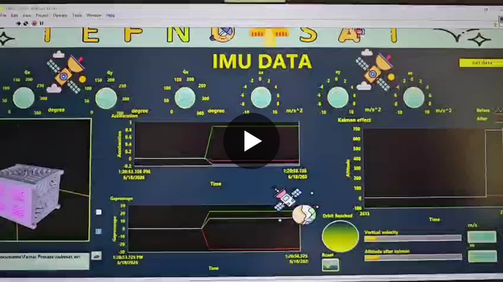

# TefnuSAT CubeSat - Ground Control Station

Real-time ground control station (GCS) software for TefnuSAT, a 1U Earth-observation CubeSat developed under the NSSAT satellite club to monitor coastal erosion along Egypt's northern coastline and track shoreline changes over time.

## What it does

The GCS is the main interface between the satellite and its operators, built to handle communication, telemetry monitoring, data processing, visualization and mission support in real time:

- Real-time RF telemetry communication using the NI-VISA protocol, with multi-packet data streaming and no buffer overflow.
- Telemetry parsing, processing and subsystem health monitoring.
- Kalman Filter-based altitude and velocity estimation for improved measurement accuracy.
- Real-time orbit tracking and mission visualization.
- Cloud integration for payload image retrieval through Web APIs.
- Automatic telemetry logging with timestamped data archiving for post-mission analysis.
- Advanced GUI with live telemetry displays and a 3D CubeSat attitude visualization.

## Role

Ground Control Station Engineer - designed and developed the ground station software end to end over roughly five months, and worked through the practical engineering challenges of communication setup, sensor data handling, telemetry architecture, system integration and real-time data processing. Also collaborated on multidisciplinary subsystem integration and data architecture verification across the CubeSat team (mission design, orbital analysis, ADCS, communications, power, embedded systems, structure and ground segment).

## Tools & stack

- LabVIEW (core GCS application and GUI)
- NI-VISA protocol (RF telemetry interface)
- Kalman Filter algorithms (altitude/velocity estimation)
- Web APIs (cloud payload image retrieval)

## Recognition

- Best GNC Track - TefnuSAT Project

## Links

- Project post: https://www.linkedin.com/posts/aya-mubarak-829862298_tefnusat-cubesat-nssat-activity-7474926422596444160-F3Ya
- Mission overview post: https://www.linkedin.com/posts/aya-mubarak-829862298_tefnusat-nssat-cubesat-activity-7475985261777108992-tdXF

## Status

README and project images first; source code and sample telemetry logs can be added later.
